# AG-1 · 反重力飞行器工程可视化

> 一个**百万零件级**的飞行器概念设计工程：参数化几何生成 + 真实电气设计 + 数值电路仿真 +
> 浏览器交互剖视。不是渲染图集，是**可重跑的生成器**。

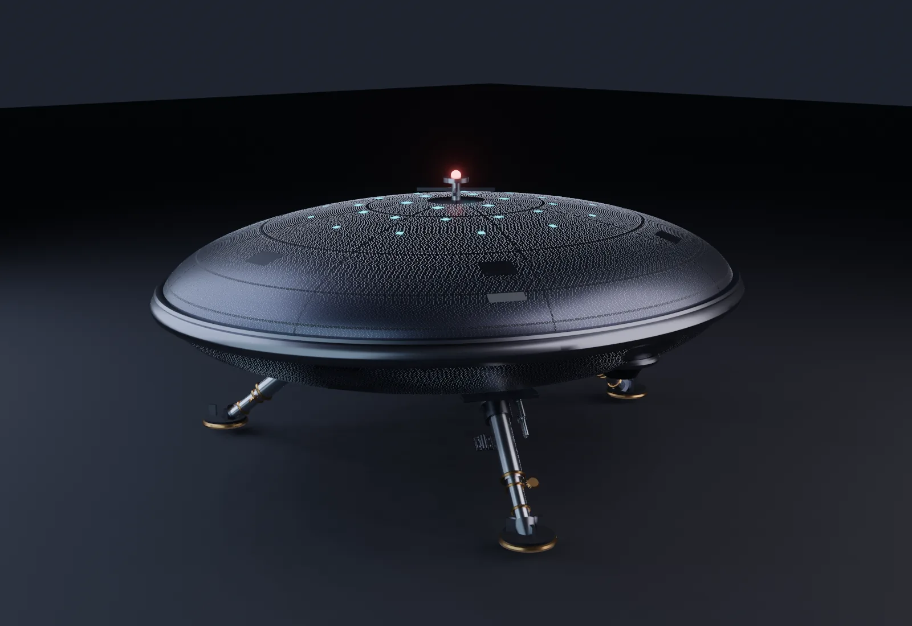

## 这是什么

AG-1 是一台**碟形**（非飞机造型）的负质量升力体概念设计。
这个仓库包含它从"物理设定"到"可交互三维模型"的完整生成链路：

- **1,013,156 个零件**（其中 62% 是铆钉类紧固件），三角面 768 万
- **7 块真实 PCB**（KiCad 工程可打开，185 个器件、19 条网络）
- **数值电路仿真**（RK4 积分求解谐振逆变器 + Cockcroft-Walton 倍压，不是画曲线）
- **单文件离线交互页**（three.js，11 MB，双击即开）

## 规模

| 项 | 数值 |
|---|---|
| 零件总数 | **1,013,156** |
| 独立建模部件 | 563 |
| 实例化标准件 | 1,012,593（22 个零件族） |
| 三角面 | 7,682,688 |
| 外蒙皮铆钉 | 325,590（间距 8.6 mm，交错排布） |
| 隔热瓦 | 127,998 |
| 内衬板铆钉 | 163,652 |
| 线圈利兹线股 | 72,000 |

> 参照：汽车 1~3 万件，A380 约 400 万件（其中 75% 是紧固件）。
> 本工程的重点不是追平系统件数量，而是把"结构件的层次密度"做到工程可信。

## 图

| | |
|---|---|
| <br><sub>百万零件整体（1,013,156 件）</sub> |
| 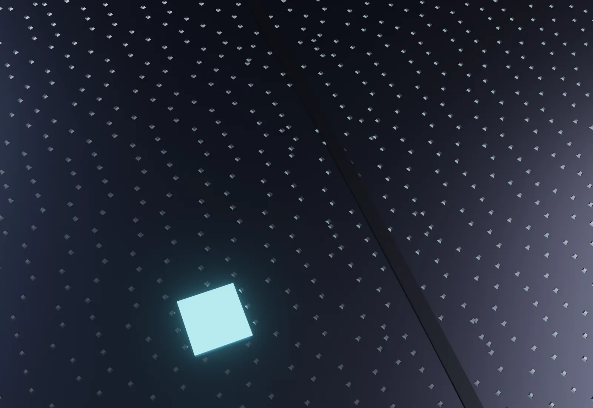<br><sub>蒙皮铆钉微距</sub> |
| 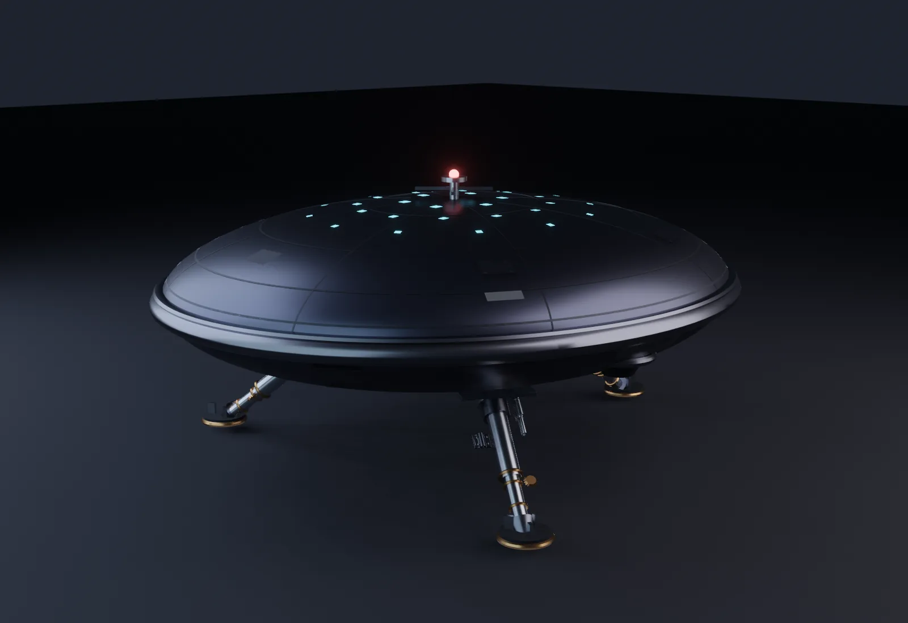<br><sub>UFO 外形与三节鱼竿式起落架</sub> |
| 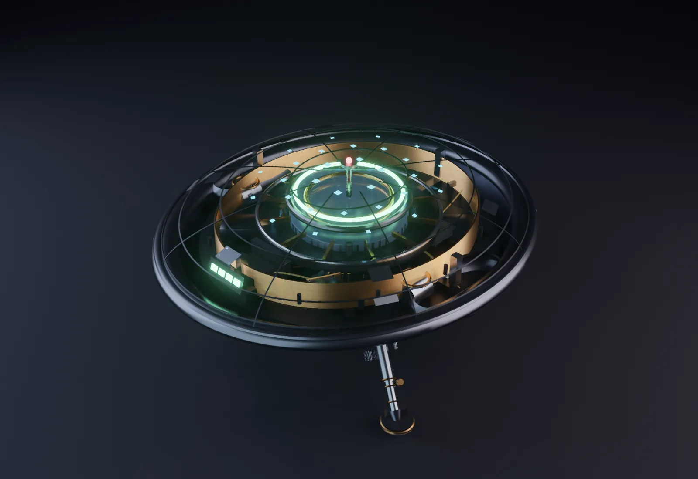<br><sub>半剖视图</sub> |
| 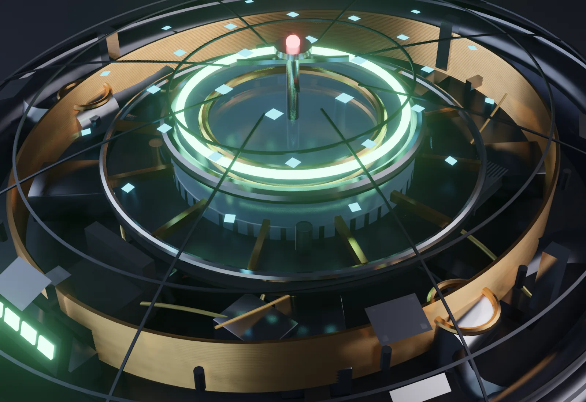<br><sub>内部透视图</sub> |
| 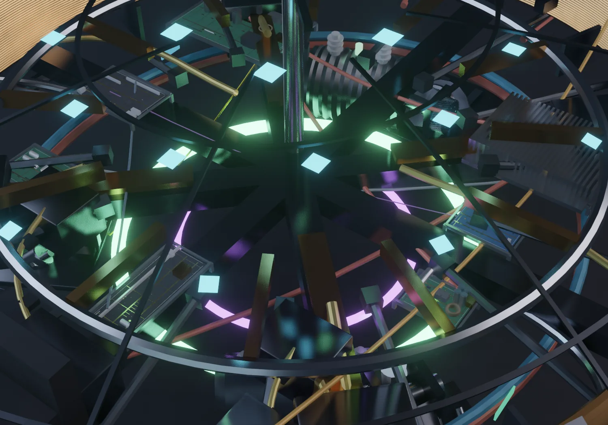<br><sub>设备层详解</sub> |
| 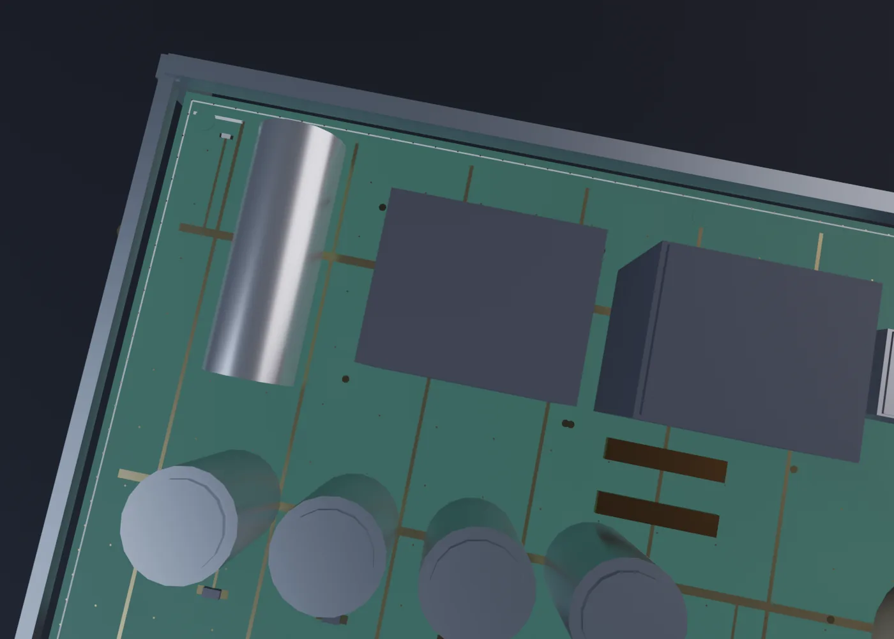<br><sub>PCB 焊盘与过孔微距</sub> |
| 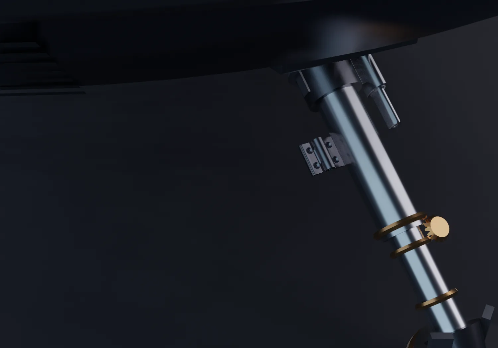<br><sub>起落架真实件特写</sub> |
| 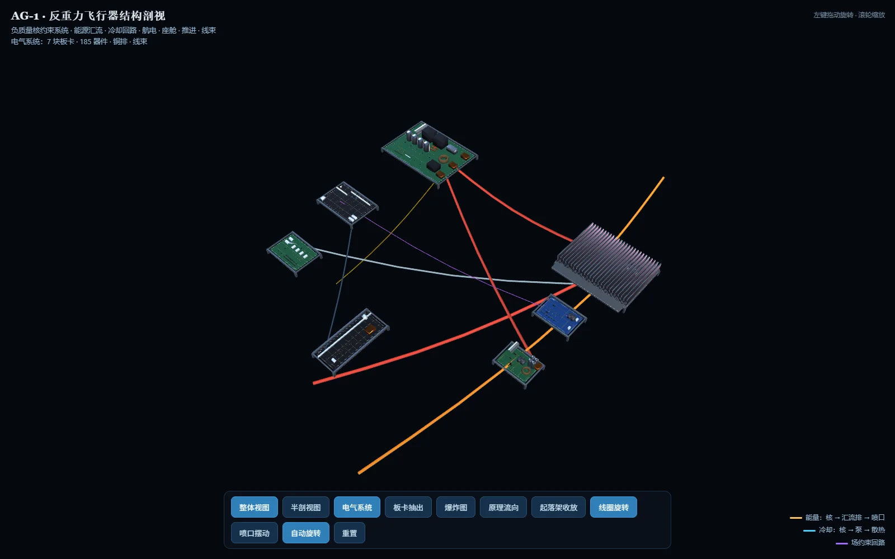<br><sub>交互页电气视图</sub> |
| 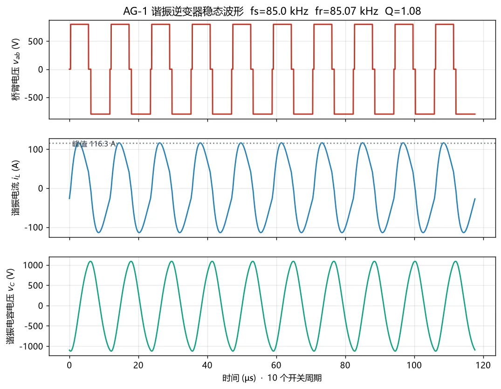<br><sub>谐振逆变器仿真波形</sub> |
| 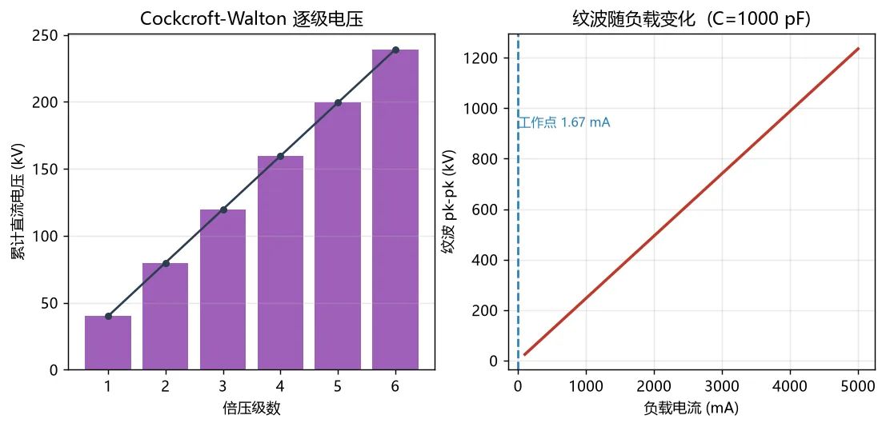<br><sub>CW 倍压逐级电压</sub> |
| 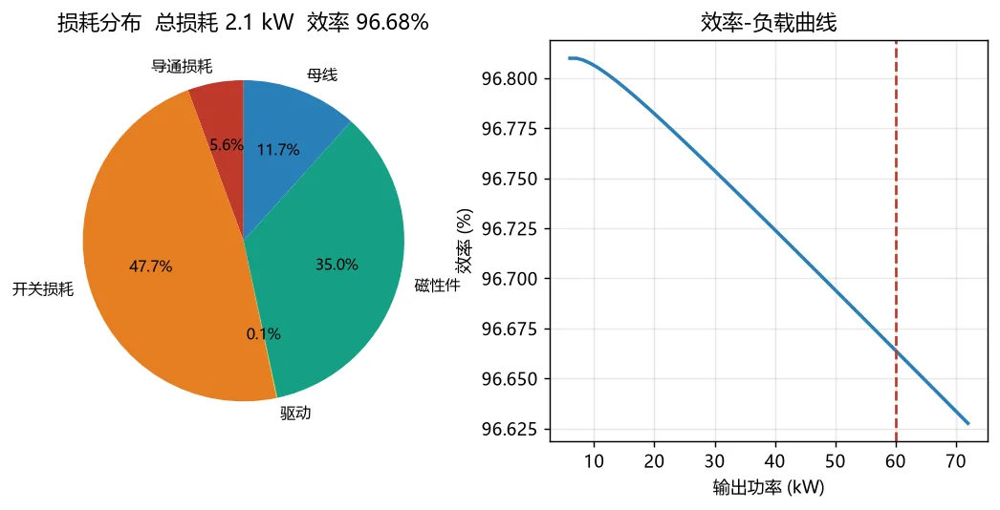<br><sub>损耗与效率</sub> |

## 技术栈

| 层 | 工具 | 说明 |
|---|---|---|
| 几何生成 | Python + `bpy`（Blender 3.5 headless） | 参数化硬表面建模 |
| 真实零件 | OCP / OpenCASCADE | 解析厂商 STEP → 三角化 → 特征提取（孔位/回转轴） |
| 渲染 | Blender EEVEE | GPU 渲染，限 2 线程防网卡断电 |
| 电气设计 | 自写 KiCad S-expression 生成器 | 不装 KiCad 也能产出 `.kicad_pcb` |
| 电路仿真 | numpy + 自写 RK4 积分 | 状态方程积分，非 SPICE 近似 |
| 交互 | three.js + InstancedMesh | 百万实例单文件离线页 |
| 碰撞检测 | Bullet3 GImpact | 精确三角网格窄相检测 |

## 目录

```
blender/           Blender 侧生成器
  build_ag1_cutaway.py   机体 + 起落架 + 线圈（主脚本）
  build_viewer.py        生成单文件 three.js 交互页
  render_from_json.py    通用渲染器（只依赖 JSON + 视角表）
  massparts.py           百万零件族定义与分布算法
  massmesh.py            实例族 → Blender 合并网格
  gen_body_detail.py     外壳表面细节
  gen_internal_detail.py 内部设备（变压器/CW罐/桁架/集管）
  step_probe.py          STEP 尺寸探测 + OBJ 导出
  step_features.py       STEP 工程特征提取
  _prep_collide.py       碰撞检测预处理
  collide_check.cpp      Bullet3 GImpact 检测器
electrical/        电气系统
  ag1_elec_spec.py       唯一事实源（板卡/器件/网络/线束/仿真参数）
  gen_pcb.py             → KiCad 工程
  gen_elec3d.py          → 3D 几何
  gen_sim.py             → 数值仿真
  kicad/                 7 套可直接打开的工程
assets/images/     成品图（WebP）
vendor/            three.js r150（离线）
docs/              技术文档
```

## 快速开始

### 依赖

- Blender 3.5+（命令行可调用）
- Python 3.9+，`numpy`、`matplotlib`、`Pillow`、`cadquery-ocp`（解析 STEP 用）

### 生成模型

```bash
export AG1_ROOT=/path/to/this/repo     # Windows: set AG1_ROOT=...

# 1) 机体 → JSON
blender -b -t 2 --python blender/build_ag1_cutaway.py -- export

# 2) 电气 3D
python electrical/gen_elec3d.py

# 3) 外壳细节 + 内部细节
python blender/gen_body_detail.py
python blender/gen_internal_detail.py

# 4) 合并（含干涉校验）
python blender/merge_elec.py

# 5) 交互页
python blender/build_viewer.py
```

> 注意：`build_viewer.py` 需要 `vendor/three.min.js`；
> 如果 `blender/out/three.min.js` 不存在，把仓库里的 `vendor/three.min.js` 复制过去。

### 出图

```bash
# 全量（含百万零件，密度 40%）
MASS=1 MASS_DENSITY=0.40 VIEWS=hero,skin RESX=1600 RESY=1100   blender -b -t 2 --python blender/render_from_json.py --   blender/out/ag1_model_full.json blender/out demo
```

视角：`hero` `top` `front` `side` `cut` `elec` `inner` `pcb` `pcbzoom` `gear` `skin`

### 电气

```bash
python electrical/ag1_elec_spec.py     # 打印汇总
python electrical/gen_pcb.py           # 生成 7 套 KiCad 工程
python electrical/gen_sim.py           # 跑仿真 + 出图
```

## 关键设计决策

### 1. 为什么是"零件族 + 算法"，不是百万个独立网格

101 万个独立几何的 JSON 会是几个 GB。改成**只传参数、两端各自生成**：
文件只增加 ~20 KB，浏览器点「零件满载」现场算出 101 万个实例。

Python 与 JS 必须**逐位一致**，否则 Blender 图和网页会看到两台不同的机器：

- 弧长积分都用 `Np = 4000` 段
- 椭圆周长都用 Ramanujan 近似
- 伪随机统一用 **Park-Miller**（`s = 16807*s % 2147483647`）——
  Python 大整数乘法与 JS `Math.imul` 在高位会分叉

### 2. 起落架为什么是"三节鱼竿式 + 先缩后翻"

腿展开要 1.2 m 才够落地，但机身内部舱高只有约 1 m。
任何整体转动都会让长腿**横穿核舱**（碰撞检测一次报出 360 处穿透）。

改成：三节先缩回 0.40 m → 再整体翻转 −0.68 rad 贴到壳体内侧。
转角必须是**负值**：`tan = (−uy, ux, 0)` 指向 −X，正角等于向下转。

### 3. 碰撞检测为什么必须用 GImpact 而不是凸包

`btConvexHullShape` 会把**线圈环的中空填实**，制造上百个假碰撞。
换成 `btGImpactMeshShape`（精确三角网格）+ `btGImpactCollisionAlgorithm` 后，
穿透数从 360 → 42 → 24 → 4 → **0**。

### 4. 电气功率为什么从 240 kW 改成 60 kW

最初按 240 kW 设计全桥，算出每管损耗 1.86 kW、结温 **376 °C**——
4 个 450 A 模块根本散不掉。**物理上不成立的设计就得改**。

最终定为 60 kW 谐振单元（全机 240 kW 由推进 / 悬浮 / 高压三个子系统分担），
重算后效率 96.68%、结温 110.6 °C（余量 64 K）。

### 5. 渲染为什么限 2 线程

本机 Intel AX201 网卡在 CPU 满载时会被功耗墙复位导致断网
（`7002 CTDP power limit` → `8000 Miniport Halt`）。
`-t 2` + EEVEE（GPU）可以避免。

## 仿真结果（RK4 实算）

| 项 | 结果 |
|---|---|
| 谐振频率 / 开关频率 | 85.07 kHz / 85.0 kHz |
| 谐振电流峰值 / RMS | 116.3 A / 82.5 A |
| 输出功率 | 58.8 kW（标称 60 kW，−2.02% = 死区 + 谐波损失） |
| CW 6 级倍压输出 | 239.05 kV，纹波 **0.173%** |
| 线圈阶跃峰值 | 30.88 A @ 3.0 µs，392 mT |
| 总损耗 / 效率 | 2058.9 W / **96.68%** |
| 结温（热阻链） | **110.6 °C**，余量 64.4 K |

## 说明

- 这是**概念设计 + 工程可视化**，不是可制造图纸。
- 反重力部分基于负质量假设（见 `docs/`），**不是现有物理的结论**。
- 几何是参数化程序生成，不是手工雕刻的硬表面模型。
- 材质是程序化噪声，不是 UV 贴图。

## 许可

MIT。如需限制商业使用，请替换 `LICENSE` 为 PolyForm Noncommercial 1.0.0。
